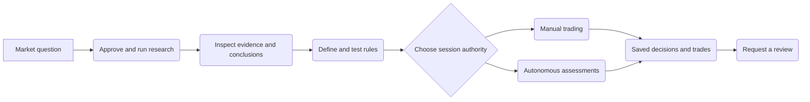

Cortiq is a Windows desktop workspace for researching one market, testing trading rules, and trading through MetaTrader 5. Use AI to investigate evidence, work in a Manual session, or authorize an Autonomous session within defined limits.

:::danger
Trading risk exists in all markets. Cortiq is a trading tool, not a profit guarantee. Use conservative risk limits, test in virtual mode first, and review your own regulatory obligations before deploying live capital.
:::

## What this is

Cortiq keeps research, saved instrument knowledge, strategy rules, historical tests, and trading evidence together. Start with a question about a market, inspect its measured answers, and decide what deserves further testing or use in a session.

You choose the authority granted to AI. In a Manual session, you place orders and explicitly request any agent action. An Autonomous session repeatedly assesses permitted market context, maintains its market understanding and opportunities, and can act within the rules and risk limits you approve. A reviewed automated trade idea has its own bounded mandate inside a Manual session.

These docs cover the full surface: what Cortiq is, how to install it, the screens you work in day-to-day, and how to design playbooks, run sessions, and audit results.

## How it fits into Cortiq

Each session is locked to one instrument and one configured account. Research and historical replay have their own saved inputs and results; they do not require a running trading session. Saving research does not automatically publish a Learning or authorize an executable Edge.

*You choose when to move from research to testing, trading, and review; completing one stage does not automatically authorize the next.*

Start research from [Instrument Hub](/cortiq-public/instrument-hub/): prepare Data, create a saved draft, check its questions and measurements, then select **Approve and start research**. Inspect the answers and explicitly review a Learning before saving it.

## Reference

| Area | What Cortiq does |
| --- | --- |
| Decision support | Sends structured market context to AI providers and receives trading decisions back in a controlled format. |
| Trade execution | Connects to a local MetaTrader 5 terminal to place, modify, and close trades. |
| Strategy control | Encodes your logic in playbooks and data access policies so the AI executes inside the framework you define. |
| Risk control | Applies global and per-account risk limits before and during every trade. |
| Validation | Replays manual or autonomous execution against historical prices with simulated positions and saved run settings. |
| Operations | Tracks sessions, journals, notifications, system messages, and account activity in one desktop workspace. |
| Research and review | Measures instrument behavior, saves reviewed Learnings, and explicitly reviews recorded decisions and Observations. |

:::note
This site shares its repository with Cortiq's GitHub Releases, Issues, and Discussions — keeping docs, the Windows installer, bug reports, and usage questions in one public place.
:::

## What to read next

1. [Getting started](/cortiq-public/getting-started/) — orientation if you're evaluating Cortiq, including who it's for and what the first day looks like.
2. [App navigation guide](/cortiq-public/app-navigation-guide/) — maps every doc to the matching sidebar entry and screen in the desktop app.
3. [Feature overview](/cortiq-public/feature-overview/) and [Capability reference](/cortiq-public/capability-reference/) — the at-a-glance and function-by-function maps of everything Cortiq does.
4. [Installation & activation](/cortiq-public/installation-and-activation/) — the Windows install and license activation flow.
5. [First 30 minutes in Cortiq](/cortiq-public/first-30-minutes/) — guided walkthrough from install to your first safe virtual session.
6. [MetaTrader 5 integration](/cortiq-public/mt5-integration/) and [AI providers](/cortiq-public/ai-providers/) — read these before your first live setup.
7. [Playbooks & data access policies](/cortiq-public/playbooks-and-data/), [Sessions](/cortiq-public/sessions/), and [Risk management](/cortiq-public/risk-management/) — the building blocks of your operating model.
8. [Backtesting](/cortiq-public/backtesting/) — configure a standalone historical replay, inspect its evidence, and review the results.
9. [Workspace & monitoring](/cortiq-public/workspace-and-monitoring/) and [Session reviews](/cortiq-public/session-review/) — the day-to-day screens, plus explicit reviews of saved evidence and proposed improvements.

## Related

- [Documentation map](/cortiq-public/documentation-map/)
- [Feature overview](/cortiq-public/feature-overview/)
- [Glossary](/cortiq-public/glossary/)
- [Licensing & support](/cortiq-public/licensing-and-support/)
- [FAQ](/cortiq-public/faq/)
