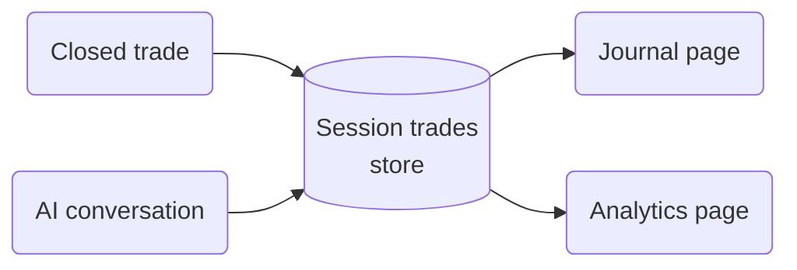

This page covers the review surface of Cortiq: trade journals, session journals, analytics, cohort comparison, and the raw conversations view. By the end you'll know which screen answers which review question and the loop that ties them together.

## What this is

Cortiq is not only about opening trades — it's also about understanding what happened and whether the workflow is improving. The review surface is built around that understanding.

The Journal opens to **Overview**, where you can look across saved sessions.
Use **Trades** to filter the records and open an individual trade. The
Journal remembers your last applied filters. The session's **Reviews** tab
contains its evidence-backed reviews.

Analytics summarizes results, cohorts compare sessions side by side, and Conversations shows the saved AI dialogue. Explicit reviews assess saved decisions, capture supported Observations, and propose improvements.

## How it fits into Cortiq

*Saved trades and AI activity support journal, analytics, and review views. The desktop does not offer scheduled Telegram reports.*

The review surface lives across five screens:

- `Library` → `Journal` — cross-session analytics, the inbox, and saved trades.
- `Library` → `Dashboard` — performance and risk overview.
- `Library` → `Session Reviews` — saved review versions and links to each session's review controls.
- the existing `/cohorts` screen — side-by-side session comparison.
- the existing `/conversations` screen — raw AI conversations across sessions.

## How to use it

### Record and reflect on a trade

1. After a Manual order is placed, use **Journal this trade** to record your
   entry reason, playbook, confidence, setup grade, emotion, and exit plan.
2. Open **Library → Journal** to see trades that still need a reason or a
   reflection. Select a trade to see its notes and saved placement details.
3. After close, use **Reflect** to record how closely you followed your plan,
   mistakes, and one lesson. A reason added after close is labelled with its
   timing.

Manage reusable tags and mistake labels under **Settings → Journal**. The
end-of-day reflection reminder is off by default.

:::caution
Updating from the earlier Journal removes its free-text trade notes and
comma-separated tags. Trade ratings are retained.
:::

### Journal trades placed in MetaTrader

In **Trades**, set **Source** to **MetaTrader** to find closed positions you
placed directly in a configured terminal. Open a position and use **Reflect**
to explain why you took it. Cortiq labels that reason as written after close.
The first save keeps the position and its Journal entries available when the
terminal is offline or older history is unavailable.

For a single confirmed entry, save the original stop to see MAE and MFE in R
when candle data is available. Net in R requires the original cash risk.
Overview reports how many MetaTrader trades came from current history and
how many came from saved snapshots.

### Read a closed trade's metrics

Open a closed trade and look for **Trade metrics**. R is the net result after
costs divided by the original risk in your account currency. MAE is the
largest move against the trade, and MFE is the largest move in its favor.
Exit efficiency compares the net result with the most the position gained
while it was open.

The card shows where the original stop came from. If a confirmed entry has
no recorded stop, you can enter it once using **Save original stop**.
Some historical trades have enough information for price or excursion R
values while account-currency risk stays unavailable.

Cortiq uses one-minute candles, including the full fill and close minutes.
Check the candle count before relying on an excursion with gaps. Exact
partial-exit deals are used when the account history supplies them. Select
**Refresh** to see whether pending results have arrived.

### Check a trade against a playbook

Choose a playbook in **Journal this trade** or the trade's plan. **Playbook
fit** checks the saved version's schedule, symbols, sessions, reward/risk,
risk and timeframes against recorded evidence. **Not determinable** means
the check needs more saved evidence. Before a fill, the card labels checks
that use submitted order details.

Use **Settings → Journal → Pre-trade checklist** to add items for all
trades or for one playbook. Answer the relevant items and save the plan.
Cortiq records the time of each answer.

After close, **Suggested mistakes** shows the facts behind each suggestion.
Choose **Accept** to add a mistake label to the trade or **Dismiss** to hide
the suggestion. The bundled ZmqFacade 1.13.0 supplies the confirmed MT5
exit details used by the early-exit check.

### Plan and review a trading day

Select a day in the **Overview** calendar. Choose **All accounts** or a
specific account to see the trades and results for that scope. Its dates
follow your timezone and the trading day start in risk settings.

Use **Pre-market plan** to name the playbooks you want to focus on and set
an entry time, maximum trade count or daily loss limit. Enter the currency
for a loss limit. A trade can receive a mistake suggestion when it exceeds
a rule that was already saved at entry. Save your notes and mood under
**Day review** after trading.

The first Manual session you open for an account offers its daily plan.
Dismiss it on the session or turn it off under **Settings → Journal**.

### Establish a review rhythm

Don't open the journal only when something goes wrong. The loop that produces compounding improvement looks like this:

1. Make one strategy change (playbook section, data access policy input, or risk limit).
2. Run the updated logic in a controlled scope — one symbol, one session.
3. Review the session journal end-to-end, not only the trade list.
4. Check whether the metric you intended to move actually moved.
5. Adjust before changing anything else.

Changing two things at once turns the review into guesswork.

### Filter and export your trades

Use the filters on **Overview** or **Trades** to choose local trading dates,
accounts, sessions, symbols, playbooks, and journal labels. You can narrow
the view by live or paper mode, outcome, emotion, adherence, or checklist
completion. Filter choices travel with the Journal link.

Overview shows equity, drawdown, the calendar, the weekly summary, and
breakdowns including results by adherence and mistake label. Monetary
results are grouped by currency and mode. The coverage counts show which
trades had complete net, R, and excursion data.

On **Trades**, choose **Export CSV** or **Export PDF** to save the filtered
records in your Cortiq exports folder under Documents.

### Read the right journal for the question

| Question | Journal to read |
| --- | --- |
| Did this single trade follow the playbook? | Trade journal. |
| Did this session stay disciplined over the day? | Session journal. |
| Did the AI's reasoning change after I edited the playbook? | Conversations view + session journal. |
| How does this run compare to last week's? | Analytics and cohorts. |
| Which configuration is winning across multiple sessions? | Cohorts. |
| What should I change for the next run on this symbol? | Session review. |

### Ask Copilot about a saved trade

1. Open **Library → Journal → Trades** and select the saved trade.
2. Select **Ask Copilot about this trade** to start a conversation about the selected trade.
3. Ask follow-up questions in the Copilot dock using the saved trade and action history.

### Compare configurations with cohorts

Open the existing `/cohorts` route or a contextual cohort link and group sessions you want to compare. Cohorts is not a current sidebar entry. Cohorts work best when the sessions actually match on most variables — same symbol, same provider, same risk profile — and differ only on the lever you're testing. Comparing two sessions that differ on five variables tells you nothing.

### Review saved evidence explicitly

Select **Review in Copilot** to open the session's **Reviews** tab. Choose **Latest cycles**, **Completed trades**, or **Date range**, then select **Prepare review**. Check the frozen scope before **Start review** sends the first Copilot request. Active sessions are reviewable through their saved cutoff; in-flight cycles are excluded.

Read the assessment and coverage in the dedicated conversation. Save a draft or publish with its limitations. Open admitted Observations to inspect their proof, and save proposed rule changes through the relevant editor.

Historical lessons remain read-only and are no longer injected into later trading prompts. See [Session review](/cortiq-public/session-review/) for reopening a review, coverage, billing, and older attempt recovery.

### Compare existing groups

Cohort and conversation screens remain available through their existing routes or contextual links, although they are not entries in the current main sidebar. The [navigation guide](/cortiq-public/app-navigation-guide/) maps the current visible screens.

## Reference

### Metrics computed by the analytics layer

| Metric | What it tells you |
| --- | --- |
| Daily P/L | Today's net profit or loss across the configured scope. |
| Weekly P/L | The current week's net result. |
| Total P/L | Cumulative across all included sessions. |
| Win rate | Percentage of trades that closed in profit. |
| Best and worst day | The single days with the highest gain and loss. |
| Best and worst trade | Outlier trades on either side. |
| Average win / average loss | The expected size of each side; the ratio matters more than either number alone. |
| Total trade count | Activity volume; useful for spotting overtrading. |

### Journal scopes

| Scope | Records | Useful for |
| --- | --- | --- |
| Trade | One trade's entry, management, exit, and AI reasoning. | Single-decision review. |
| Session | Every cycle in a session window. | Strategy-level review. |
| Run | One start-to-stop execution. | Comparing executions of the same configuration. |

## Common questions

**My win rate dropped after a playbook change — should I roll back?**
Not yet. Open the session journal and check whether losing trades are losing for the same reason. A higher loss rate on disciplined trades means the playbook now passes on setups the old version took — that may be the desired change. A higher loss rate on improvised trades means the playbook lost structure.

**Cohort comparison shows two sessions are very different — what's it actually telling me?**
Cohorts surface differences; they don't explain them. Use cohorts to find the gap, then open the session journals on both sides to read the cycles where the divergence appeared.

**How long is journal data kept?**
For the lifetime of the local Cortiq install. Journals live in the local SQLite database; they don't expire. Back up `cortiq.db` with the rest of your machine if you want offsite history.

## What to read next

1. [Session review](/cortiq-public/session-review/) — explicit assessment, Observations, coverage, and proposed improvements.
2. [Workspace & monitoring](/cortiq-public/workspace-and-monitoring/) — the screens that surface the journal data.
3. [Execution modes & notifications](/cortiq-public/execution-modes-and-notifications/) — Windows trade notifications, Activity, and price alerts.
4. [Playbook design guide](/cortiq-public/trading-cycle/playbook-design/) — the iteration that the journal-driven loop should produce.

## Screenshots

Screenshots use sample data. Connection states and amounts are illustrative.

Use the session's Decision Log to inspect decisions that produced no trade.

*Illustrative demo statistics, not trading results from a customer account.*

## Related

- [Sessions](/cortiq-public/sessions/)
- [Risk management](/cortiq-public/risk-management/)
- [Capability reference](/cortiq-public/capability-reference/)
- [Glossary](/cortiq-public/glossary/)
