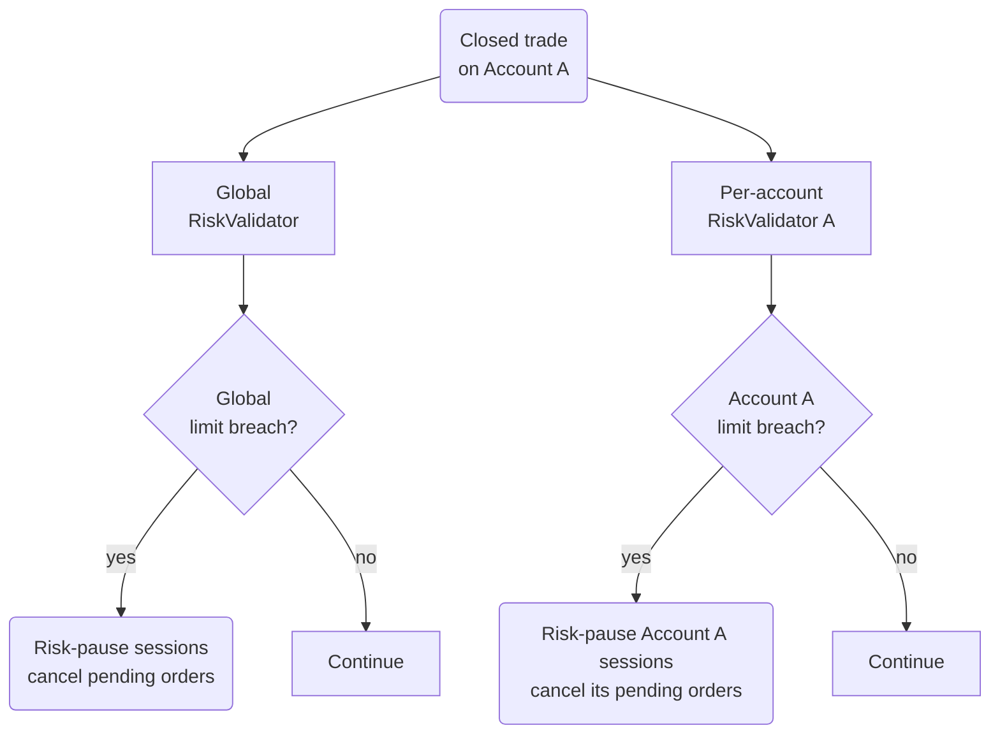

Configure global and per-account limits before trading, then inspect their entry checks, risk pauses, and monitoring limits. These controls complement broker-side protection; they cannot guarantee an execution price or a maximum realized loss.

:::danger
Live trading without configured risk limits sends real orders with no platform-level circuit breaker. Configure global and per-account limits before a session ever runs in non-virtual mode. The AI's judgment is not a substitute for risk validators.
:::

## What this is

Cortiq does not assume a good AI response is enough. Every trading system needs an independent control layer above execution, and that layer is built into the product.

The risk system is **dual-layer**. Global limits apply across every connected MT5 account; per-account limits apply to one account in isolation. Entry validation checks both applicable layers. Filled entries update the entry ledger, and closed trades update realized P/L. Independent background polling also checks supported daily realized-plus-unrealized thresholds.

The two layers exist because most operators have at least two simultaneous mandates: a *whole environment* mandate (don't let total daily drawdown exceed X) and a *per-account* mandate (don't let prop-firm Account A exceed its specific challenge limits). Mixing the two into one rule set produces rules that are wrong for both.

## How it fits into Cortiq

*Each closed trade is recorded in both validators. The two breach paths are independent: a global hard breach affects all accounts; an account hard breach affects that account.*

Risk is visible in two screens:

- `Tools` → `Risk Management` — configure global and per-account limits.
- `Library` → `Dashboard` — monitor real-time risk usage across the environment.

## How to use it

### Configure global limits first

Open `Tools` → `Risk Management` and select the `Global` tab. Set conservative defaults before any live execution.

Set limits for the exposure you intend to authorize. Monitoring and broker execution introduce delay, so a configured threshold is not a guaranteed loss ceiling.

### Configure per-account limits

Switch to the `Per-Account` tab and configure rules for each MT5 account independently. Use this to encode account-specific mandates: prop-firm challenge limits, a personal account's daily drawdown, a secondary account's max exposure.

### Configure your day-start time

Set each layer's day-start time to match the trading day you intend to measure. The configured local boundary is converted for UTC tracking. Weekly counters use the Sunday-anchored trading week at that boundary, rather than a rolling seven-day window. Global and account boundaries can differ.

### Watch for `RiskPaused` sessions

A hard breach can put affected sessions into `RiskPaused`. Inspect its recorded reason and remaining exposure. The automatic resumer checks global absolute daily/weekly P/L thresholds and the global daily entry count, then attempts the ordinary start checks.

The resumer does not re-evaluate per-account breach counters or every percentage threshold. A resumed session does not prove that the original account-level breach cleared. Entry validation still applies. Disabling global risk management makes the resumer attempt a restart on its next monitoring tick. Stop the session if you need it to remain inactive while you review the breach.

## Reference

Before completing first-run setup, review the applied global and account settings and select **Confirm current limits reviewed** in the risk review panel. Home tracks this acknowledgement separately from saving the settings. If applied settings are unavailable, reload them before confirming the review.

### Backtest risk settings

Backtests capture replay-supported global and selected-account limits when they start. Edit those settings on the backtest setup page to compare a configuration without changing live account defaults. The saved run and its recovery use the captured settings. See [Backtesting](/cortiq-public/backtesting/).

### Limits the platform enforces

| Limit | Layer | Triggers when |
| --- | --- | --- |
| Maximum daily drawdown | Global, per-account | Realized loss reaches an enabled absolute or balance-percentage cap; independent polling also checks realized + unrealized daily loss. |
| Maximum weekly drawdown | Global, per-account | Realized loss reaches an enabled cap within the configured Sunday-anchored trading week. |
| Daily profit target | Global, per-account | Realized daily P/L reaches an enabled target; polling also checks realized + unrealized daily P/L. |
| Weekly profit target | Global, per-account | Cumulative weekly P/L meets the configured target. |
| Maximum daily trade count | Global, per-account | Executed or filled entries in the trading day reach the cap. Closing a trade does not create another entry. |
| Maximum total open trades | Global, per-account | Concurrent open positions reach the limit. |
| Maximum trades per symbol | Global | Concurrent positions on one symbol reach the limit. |
| Maximum symbol exposure | Global | Combined risk exposure on one symbol exceeds the configured percentage of balance. |
| Default risk per trade | Global, per-account | Supplies the base percentage for risk-based sizing, subject to account, playbook, and recovery adjustments. It is not a universal ceiling on manually entered lots. |
| Stop-on-loss-streak | Global | Consecutive losing trades reach the configured count. |
| Include manual trades | Global setting | Controls whether outside/manual MT5 trades enter the managed risk scope. |

Per-account loss-streak recovery reduces sizing when enabled; it is separate from the global stop-on-loss-streak entry block.

The daily entry ledger is separate from closed-trade P/L and analytics counts. Broker history reconstruction restores recorded entries after recovery. Outstanding pending orders consume available entry capacity separately; unfilled orders are not already completed entries.

### What happens on a breach

| Layer | Effect |
| --- | --- |
| Global | Cancels all pending orders, risk-pauses every running session. |
| Per-account | Cancels the affected account's pending orders, risk-pauses that account's running sessions. Other accounts continue. |

In both cases the affected sessions move to `RiskPaused` and the breach is logged with the trigger condition.

### The emergency-stop circuit breaker

When a hard limit breaches, an emergency-stop service fires before the next trade can compound the loss. It is the circuit breaker that sits between a breach and your account:

1. It cancels pending orders — every account on a global breach, only the affected account on a per-account breach. When `Include manual trades` is off, only orders linked to Cortiq sessions are cancelled.
2. It risk-pauses every session currently `Running` in the breached scope.

A separate unrealized-P/L monitor polls open positions independently of AI cycles, every 30 seconds by default. It attempts to close exposed positions and risk-pause sessions when supported global or account *realized plus unrealized* daily loss or profit thresholds are reached. A failed account read leaves that account unchecked for that poll. Soft limits (trade count, loss streak, max open trades, symbol exposure) reject the next order but do not trip the circuit breaker.

## Common questions

**My session is `RiskPaused` — should I resume it?**
Inspect the breach and remaining exposure before allowing more activity. Automatic resumption uses the limited global-counter checks described under [risk-paused sessions](#watch-for-riskpaused-sessions); it does not prove per-account recovery. Stop the session while reviewing if you need to prevent automatic restart.

**Risk limits applied but I see a loss bigger than the daily drawdown — why?**
Entry and closed-trade checks are complemented by independent unrealized-P/L polling, rather than a cycle-end-only check. Price can move between polls, a connection can fail, and closing orders can fill with slippage or across a gap. Broker-side protective stops remain important, but they also do not guarantee the final fill price.

**Do risk limits apply to External MCP sessions?**
Yes. Both autonomous and external sessions go through the same validator pipeline before any order reaches MT5.

## What to read next

1. [Sessions](/cortiq-public/sessions/) — `RiskPaused` and the rest of the session lifecycle.
2. [Execution modes & notifications](/cortiq-public/execution-modes-and-notifications/) — virtual mode rehearses risk behavior without using capital.
3. [Journal & analytics](/cortiq-public/journal-and-analytics/) — review breaches before adjusting limits.

## Screenshots

Screenshots use sample data. Connection states and amounts are illustrative.

*Illustrative demo limits, not a recommended risk configuration.*

*Account controls differ from the global panel. Inspect the applied settings for the account you use.*

## Related

- [MetaTrader 5 integration](/cortiq-public/mt5-integration/)
- [Workspace & monitoring](/cortiq-public/workspace-and-monitoring/)
- [Capability reference](/cortiq-public/capability-reference/)
- [Glossary](/cortiq-public/glossary/)
