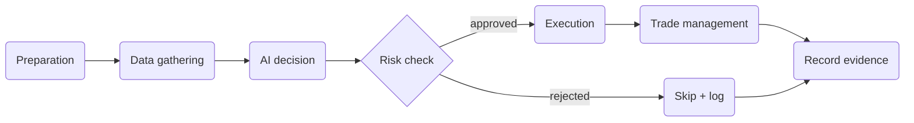

This page explains the architecture of one Cortiq cycle. By the end you'll know which pieces feed each phase and why the session — not the AI — is the right object to think outward from.

## What this is

An Autonomous session coordinates planning, market evidence, decisions, risk checks, and execution for one instrument. Playbooks, data policies, and supporting reports are optional configuration; selected rules and their required inputs still need to pass admission checks.

The phases explain the responsibilities, rather than a promise that every candle sends the same full prompt. Manual sessions have no general automatic decision cycle; [discretionary trading](/cortiq-public/discretionary-trading/) explains their controls.

## How it fits into Cortiq

*Execution records evidence as it runs. AI review is a separate action you request against that saved evidence.*

The session sits in the middle of every phase: it decides which account, symbol, provider, playbook, and data access policy are active, and when the session is allowed to run.

## How to use it

### Understand planning and meaningful wakes

Autonomous planning builds a session-owned market plan from the permitted evidence and operating rules. The retained context includes scenarios, trends, and zones so later decisions can follow the same developing market rather than start from an empty conversation.

Accepted price, candle, time, and other configured conditions determine when the workflow needs another decision. Receiving another market candle does not imply another paid AI call. Read the decision timeline to see which event caused a wake and what evidence was available.

Execution checks actual required inputs before acting. Missing candles, unavailable indicator values, or expired required reports are readiness issues rather than zero-valued evidence or an AI trading signal. Management of existing exposure has its own input and authority checks.

Initial planning and later revisions can use different reasoning effort from routine decisions while retaining the session's captured provider route. See [Sessions](/cortiq-public/sessions/) and [AI providers](/cortiq-public/ai-providers/).

### Read the cycle from the session outward

Start by understanding what the session controls, then drill into each phase as needed.

| Phase | Driven by | Read more |
| --- | --- | --- |
| Preparation | Preparation packages, instrument profiles, sentiment reports | [Supporting context](/cortiq-public/trading-cycle/supporting-context/) |
| Data gathering | Data access policy, MT5 bridge | [Data access policy design](/cortiq-public/trading-cycle/data-package-design/) |
| AI decision | Playbook, AI provider | [Playbook design](/cortiq-public/trading-cycle/playbook-design/) |
| Risk check | Risk validators (global + per-account) | [Risk management](/cortiq-public/risk-management/) |
| Execution | MT5 integration | [MetaTrader 5 integration](/cortiq-public/mt5-integration/) |
| Trade management | Playbook management rules | [Session trades and timeline](/cortiq-public/trading-cycle/entities/session-trades-and-timeline/) |
| Recorded evidence and explicit review | Journal, analytics, saved review coverage | [Session review](/cortiq-public/session-review/) |

### Add support layers when they earn their place

Playbooks and data access policies cover the core. Support layers — session instructions, preparation packages, instrument profiles, sentiment reports — let you add structure the AI shouldn't have to rediscover every cycle.

Add a layer when its absence would noticeably hurt cycle quality. Don't add layers reflexively; a noisy preparation package is as bad as a noisy data access policy.

## Reference

### How the pieces fit together

| Layer | Role | Typical question it answers |
| --- | --- | --- |
| Session | Operating container | What is this workflow allowed to do? |
| Playbooks | Strategy rules | What setups are valid? |
| Data access policy | Allowed inputs and limits | Which market evidence may the AI retrieve? |
| Trade ideas | Specific theses | What discretionary opportunities are tracked right now? |
| Preparation package | Cached analysis | What slower-moving structure should already be known? |
| Instrument profile | Long-lived behavior | How does this instrument typically behave? |
| Sentiment report | News and macro | What external pressure matters right now? |
| Session trades and timeline | Execution record | What happened and why? |

### Where most quality problems come from

| Symptom | Most likely cause |
| --- | --- |
| AI improvises too much | Playbook is too vague. |
| AI is paralyzed by noise | Data access policy has too many timeframes or indicators. |
| Decisions feel disconnected from market context | Missing support layer (preparation, instrument profile, sentiment). |
| Same trade keeps recurring incorrectly | Invalidation logic in the playbook is missing or weak. |

## What to read next

1. [Session architecture](/cortiq-public/trading-cycle/session-architecture/) — what the session itself controls and configures.
2. [Supporting context](/cortiq-public/trading-cycle/supporting-context/) — preparation, instrument profile, sentiment.
3. [Playbook design guide](/cortiq-public/trading-cycle/playbook-design/) — disciplined section-by-section playbook authoring.
4. [Data access policy design guide](/cortiq-public/trading-cycle/data-package-design/) — payload tiers, timeframes, screenshots.

## Related

- [Sessions](/cortiq-public/trading-cycle/entities/sessions/)
- [Sessions](/cortiq-public/sessions/)
- [Risk management](/cortiq-public/risk-management/)
- [Glossary](/cortiq-public/glossary/)
